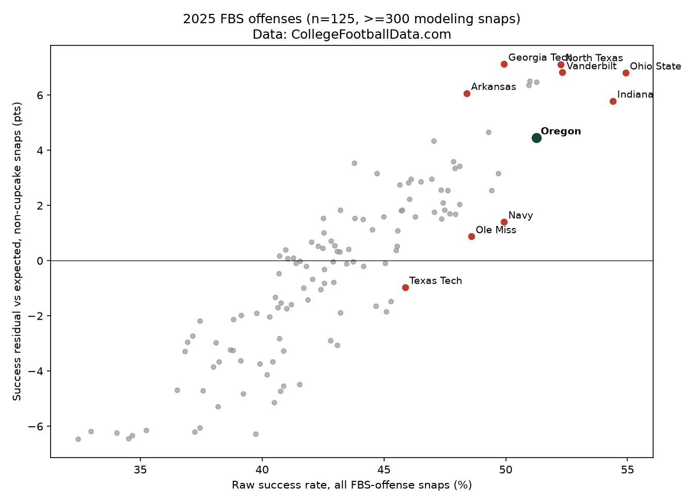
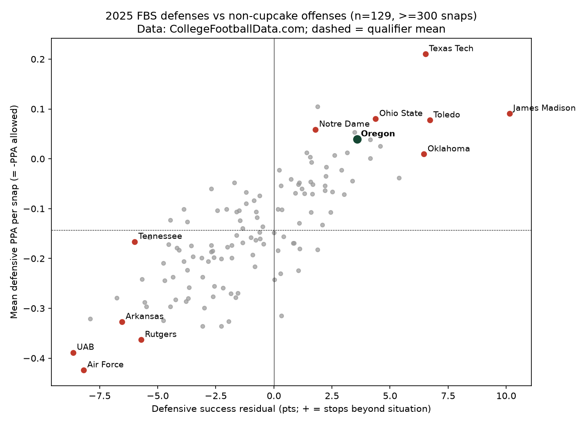
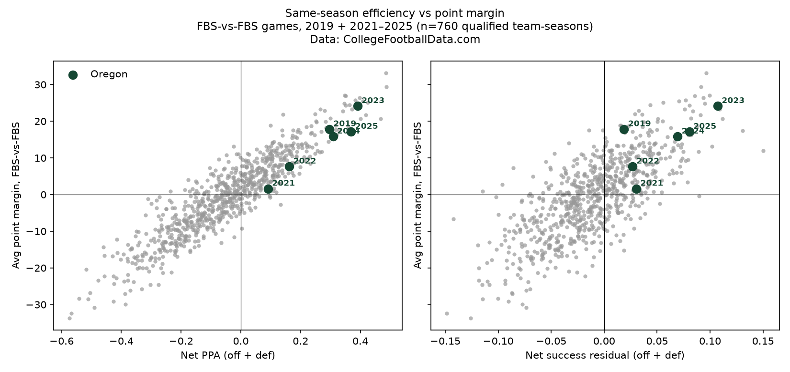
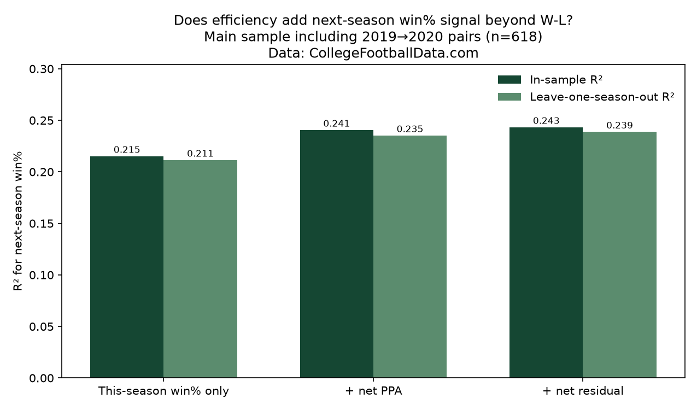
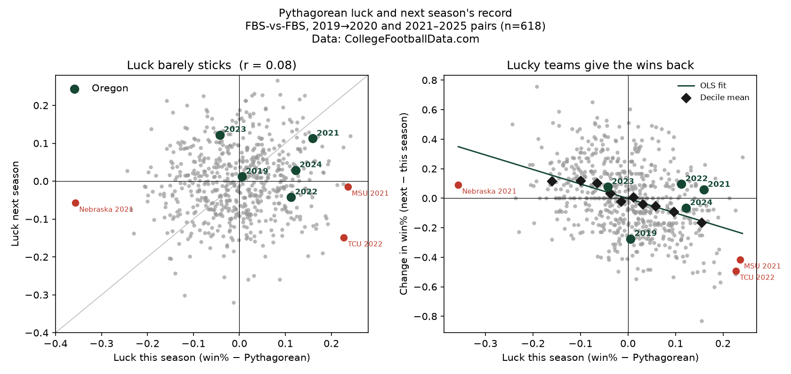
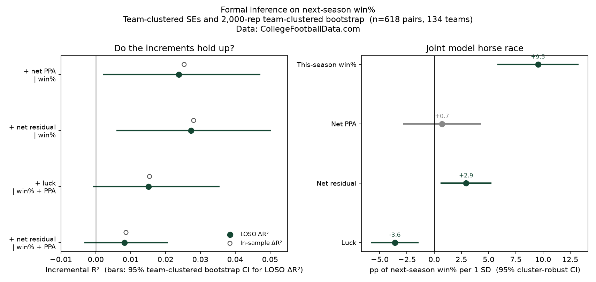

# College football situational success residuals

**Question.** After controlling for down, distance, field position, and score, which FBS offenses and defenses systematically over- or underperform classic success rate, and does that stick year to year?

**Answer.** Yes on both sides, with clear schedule inflation from FCS/cupcake snaps. Residuals persist moderately (offense r≈0.39, defense r≈0.32) but less than raw success or CFBD PPA, so pair the residual with PPA rather than replacing it.

| Modeling snaps | Residual vs mean PPA | Offense persistence | Defense persistence |
|---|---|---|---|
| 463,803 | r = 0.82 | r ≈ 0.39 | r ≈ 0.32 |

A longer narrative writeup is on this [canvas](https://cursor.com/canvas/store-0e1add33-ac59-4a72-89a6-a3a39f09265b/52f0c425-125a-44d8-83e4-85b1b1c16e93). Full numbered results are in [`docs/RESULTS.md`](docs/RESULTS.md), [`docs/RESULTS_defense.md`](docs/RESULTS_defense.md), and [`docs/RESULTS_persistence.md`](docs/RESULTS_persistence.md). The winning-extension writeups are [`docs/RESULTS_wins.md`](docs/RESULTS_wins.md), [`docs/RESULTS_luck.md`](docs/RESULTS_luck.md), and [`docs/RESULTS_inference.md`](docs/RESULTS_inference.md).

## Data and method

- **Source:** [CollegeFootballData](https://collegefootballdata.com) (CFBD) play-by-play, seasons 2019 + 2021–2025 (2020 skipped). 917,295 raw plays → 463,803 offense modeling snaps after filters.
- **Success:** classic 50/70/100 (50% of needed yards on 1st down, 70% on 2nd, 100% on 3rd/4th). Special teams (punts, kickoffs, field goals) excluded. Kneels/spikes dropped when play text allows.
- **Cupcake filter:** drop snaps vs FCS and vs low-end non-P4 (prior-year SP+ below that year's 25th percentile among FBS). The same filter is flipped for defense (drop snaps vs weak offenses).
- **Model:** pooled logistic `success ~ C(down) + distance + yardsToGoal + score_diff` on non-cupcake snaps. Residual = actual − expected. In-sample and descriptive; no team or opponent terms inside the model.
- **PPA** is CFBD's own metric, used only as an independent check (not refit). Defensive PPA = −offense PPA; defensive residual = expected − success (the offense model is reused, not refit).

## Key findings

All figures below are from `docs/RESULTS*.md` (generated 2026-11-06).

- **Schedule inflation is real, and it comes mostly from FCS games.** FCS snaps run ~51% success vs ~42% vs power defenses; about **+5.1 pts** of that gap is pure opponent weakness after situation control. Those snaps stay out of the model.

  | Opponent bucket | Snaps | Success | Expected | Residual |
  |---|---|---|---|---|
  | FCS / non-FBS | 48,020 | 51.3% | 46.2% | **+5.1** |
  | Low-end non-power FBS | 131,433 | 44.1% | 43.1% | +1.0 |
  | Other FBS | 163,310 | 41.8% | 41.8% | 0.0 |
  | Power 4/5 + Notre Dame | 300,493 | 41.7% | 41.7% | 0.0 |

- **Rankings reshuffle.** The median team moves ~10 spots vs raw success; 6–9 of each year's raw top 25 fall out of the residual top 25. Examples: 2024 Army raw #5 → residual #42 (50% cupcake share). 2025 Georgia Tech raw #9 → residual #1 (+7.1). 2025 Arkansas raw #15 → residual #8 on a hard slate.
- **Residual vs mean PPA:** r = 0.82 at the team-season level (0.80–0.85 each year).
- **Defense mirrors the same inflation** (+5.1 pts vs FCS). 2025 Oregon defense: residual +3.6 (#10), def PPA +0.040 (#8). A net view matters: in 2022, Georgia beat Oregon despite a lower offensive residual because Georgia's defense was elite (net PPA #1 vs Oregon #13).





## Oregon case study (offense)

Cupcakes do not explain Oregon's numbers (8–16% of snaps). Friendly situations do: expected success sits ~44–46%, so the residual is smaller than the raw edge. Season-level efficiency still fails single games (2023 Washington head-to-heads; 2025 Indiana).

| Year | Raw rank | Residual | Residual rank | Mean PPA rank |
|------|----------|----------|---------------|---------------|
| 2019 | #22 | +1.3 | #37 | #7 |
| 2021 | #12 | +6.1 | #8 | #31 |
| 2022 | #3 | +8.1 | #3 | #8 |
| 2023 | #1 | +10.7 | #2 | #2 |
| 2024 | #3 | +6.4 | #3 | #1 |
| 2025 | #5 | +4.5 | #11 | #2 |

## Persistence

Adjacent-year Pearson correlations, qualifiers with ≥300 modeling snaps in both seasons (488 team-pairs pooled; 2019→2021 is a COVID gap and is kept separate):

- Offense: residual **0.39**, raw success **0.47**, mean PPA **0.46**
- Defense: residual **0.32**, def PPA **0.44**

Top-quintile residual retention falls from ~48% (2021→2022) to ~32% (2024→2025). Single-season #1s often crash (UCLA, LSU, Western Kentucky). Oregon's path: +1.3 → +6.1 → +8.1 → +10.7 → +6.4 → +4.5 (elite stretch, then a soft landing).

## Extension: efficiency vs winning

Does net PPA or the net situational residual predict win% and point margin — including next season's wins — beyond the W-L record? Records and average margin are FBS-vs-FBS, regular season plus postseason (618 team-pairs, 2019 + 2021–2025). 2020 is COVID-shortened and has no residual/PPA (plays were never pulled).

| Next-season model | In-sample R² | Leave-one-season-out R² |
|---|---|---|
| This-season win% only | 0.215 | 0.211 |
| + net PPA | 0.241 | 0.235 |
| + net residual | 0.243 | 0.239 |
| win% + net PPA + luck | 0.256 | 0.250 |

- **Same-season:** r(net PPA, point margin) = 0.92; r(net residual, margin) = 0.75. Versus win%: 0.84 and 0.65.
- **Luck** (actual win% minus Pythagorean expected, exponent 2.37) barely sticks (r = 0.08). Lucky teams give the wins back almost one-for-one. The luckiest decile fell from 66.7% to 50.0% the next year (about −2.0 games per 12-game season); the unluckiest rose from 35.6% to 47.0% (+1.4 games).
- **Oregon 2021** went 9–4 with only a +1.6 margin (luck +1.9 games per 12) but did not fade, because the offense was already rising. **2021 Michigan State** (10–2, +4.8 margin, then 5–7) and **2021 Nebraska** (outscored FBS opponents, still 2–9) are the luck / unluck exemplars.
- **Formal inference** (nested F-tests, cluster-robust SEs, 2,000-rep team-clustered bootstrap): adding PPA or the residual to W-L has leave-one-season-out 95% CIs that exclude zero. In a joint model, the residual still adds +2.9 percentage points of next-season win% per SD (cluster p = 0.011); luck is −3.6 pp per SD. Net PPA's unique piece is not distinguishable from zero once the record, residual, and luck are in — mostly collinearity with win% (VIF ≈ 6.5), not a claim that PPA is useless.
- **Persistence with CIs** (n = 488 adjacent pairs): offense residual 0.39 [0.30, 0.47], raw success 0.47 [0.38, 0.54], PPA 0.46 [0.37, 0.53]. Paired differences exclude zero (PPA minus residual +0.07, p = 0.018; defensive PPA minus defense residual +0.12, p = 0.001).









Details: [`docs/RESULTS_wins.md`](docs/RESULTS_wins.md), [`docs/RESULTS_luck.md`](docs/RESULTS_luck.md), [`docs/RESULTS_inference.md`](docs/RESULTS_inference.md).

## Caveats

- In-sample and descriptive. No opponent-strength term inside the modeling sample beyond the cupcake filter.
- Short-yardage (especially 3rd & 1) is under-predicted; the additive model was kept after sensitivity checks (team-season residuals barely move; correlation across specs ≥ 0.999).
- Kneels are under-detected in 2019/2021 play text. Score fields on scoring plays may already include the points.
- Special teams are left for a later slice.
- In the winning extension, records are FBS-vs-FBS (they can differ from official all-opponent records), 2020 has no residual/PPA, and win% is collinear with net PPA (VIF ≈ 6.5).

## How to reproduce

Derived team-season tables and the writeups are included, so you can inspect results without an API key. Re-running the full pipeline requires a [CollegeFootballData API key](https://collegefootballdata.com) and will download raw play-by-play (on the order of hundreds of MB) into `data/raw/` (gitignored).

```bash
python3 -m venv .venv
source .venv/bin/activate
pip install -r requirements.txt
cp .env.example .env   # paste your key; never commit .env
make all               # or: bash src/run_all.sh
```

`src/download.py` is cached: reruns skip raw files that already exist and parse as valid JSON. Individual steps: `make download`, `make clean-data`, `make model`, `make sensitivity`, `make report`, `make defense`. The winning extension is `make luck` and `make inference` (they run from the packaged team-season and pair tables, no API key). `make wins` rebuilds those tables from CFBD `/games` and does need `CFBD_API_KEY`; raw game JSON is gitignored. `make extension` runs luck then inference. Paths are repo-relative; set `CFB_ROOT` only if you need to point the scripts at another tree. The key is read from `CFBD_API_KEY` and is never printed or written to disk.

## Repo layout

```
├── README.md
├── LICENSE                  # MIT
├── Makefile
├── requirements.txt
├── .env.example             # CFBD_API_KEY=
├── src/
│   ├── download.py          # CFBD fetch (cached)
│   ├── clean.py             # success flags, cupcake filter
│   ├── model.py             # pooled logistic + team-season residuals
│   ├── sensitivity.py       # additive vs interaction vs log-distance
│   ├── report.py            # offense tables + 2025 scatter
│   ├── defense.py           # mirrored defense ratings (no new fit)
│   ├── defense_report.py
│   ├── paths.py             # repo-relative paths; optional CFB_ROOT
│   ├── wins.py              # game results, next-season win% models
│   ├── luck.py              # Pythagorean luck regression
│   ├── inference.py         # F-tests, team-clustered bootstrap, horse race
│   └── run_all.sh
├── data/
│   ├── raw/                 # downloaded locally; not in the repo
│   ├── processed/           # calibration / funnel / persistence / extension tables
│   └── derived/             # team_season_{summary,defense,combined,wins}.csv
├── docs/                    # RESULTS*.md and the original PORTFOLIO brief
└── figures/                 # offense, defense, and winning-extension charts
```

Raw play-by-play, raw `/games` JSON, and the large `*.parquet` intermediates are not shipped. Team-season and pair CSVs are included (each well under 5 MB).
